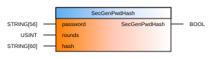
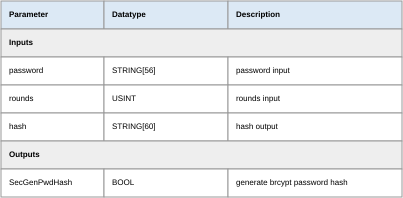
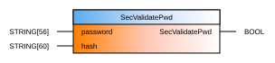
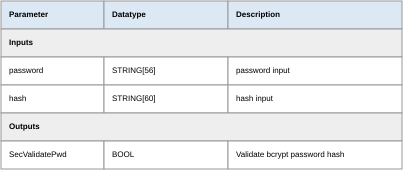
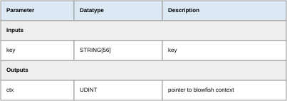
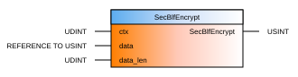
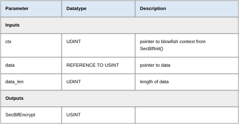

[](https://www.br-automation.com)

# BrSecurity

Security Functions for B&amp;R Automation Studio.


## License

The original source code in this repository is licensed under the MIT License.

This project also contains third-party components licensed under the BSD 4-Clause License. Such components remain subject to their original license terms.

See:

- [LICENSE](LICENSE)
- [THIRD_PARTY_LICENSES/BSD-4-Clause.txt](THIRD_PARTY_LICENSES/BSD-4-Clause.txt)

## Disclaimer

Also have a look into the [disclaimer](Disclaimer.md).

## Download

Download the Automation Studio Library [here](https://github.com/hilch/BrSecurity/releases)


## Password Hashing

### SecGenPwdHash

implements [bcrypt](https://en.wikipedia.org/wiki/Bcrypt) password hashing (origin: Open BSD).
The maximum password length is limited to 56 characters. 




You can check the hash online at [https://bcrypt-generator.com](https://bcrypt-generator.com/) or with [Bcrypt.cpp](https://github.com/hilch/Bcrypt.cpp) in your own program.


### SecValidatePwd

validates user's password against stored hash




```
PROGRAM _CYCLIC

	IF( generate_hash )THEN	
		result_password_hash := SecGenPwdHash( password, 10, password_hash );
		password := '';  (* never store password directly !! *)
		generate_hash := FALSE;
	END_IF


	password_is_valid := SecValidatePwd( password, password_hash );
  
END_PROGRAM
```

## Data Encryption / Decryption

### SecBlfInit

implements [Blowfish]() data encryption (origin: Open BSD).
Prepares and stores the Blowfish context with the given key.
Use 'ctx' output for SecBlfEncrypt() and SecBlfDecrypt.




### SecBlfEncrypt

Encrypts data pointed to by 'data' with length 'data_len'




### SecBlfDecrypt

Decrypt data pointed to by 'data' with length 'data_len'


You can check the data encryption online at [http://sladex.org/blowfish.js/](http://sladex.org/blowfish.js/)

```
PROGRAM _INIT
	brsstrcpy( ADR(data), ADR('Lorem ipsum dolor sit amet, consetetur sadipscing elitr') );
	SecBlfInit_0( key := 'top_secret' );	
	
END_PROGRAM

PROGRAM _CYCLIC
	IF( encode ) THEN
		encode := FALSE;		
		SecBlfEncrypt( SecBlfInit_0.ctx, ADR(data), brsstrlen(ADR(data)) );
	END_IF
	
	IF( decode ) THEN
		decode := FALSE;
		SecBlfDecrypt( SecBlfInit_0.ctx, ADR(data), brsstrlen(ADR(data)) );		
	END_IF
	 
END_PROGRAM
```


